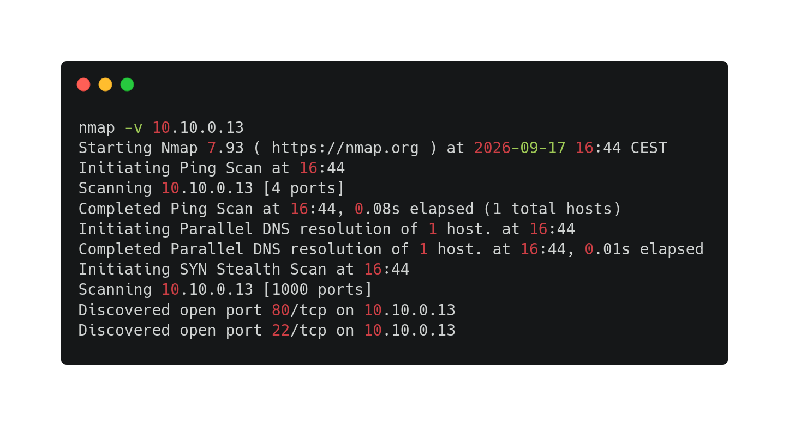
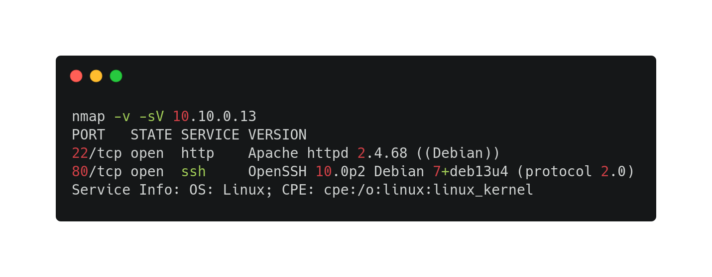

--- 

### Challenge propertie(s) :
- ##### Difficulty : medium
- ##### Techniques : scan, enumeration, steganalysis, brute force by dictionary, service authentication, privilege escalation. 
- ##### tools : nmap, gobuster steghide, hydra, cyberchef, dencode. 
- ###### tools used but output can't be exploited  :zsteg

### Challenge steps : 

#### Part 1 : user.txt

1. A basic nmap scan. 80 and 22 opened port , I tried to connect to ssh but  the connection was closed and I couldn't go to http website. That's why I decided to scan services.


2. After several minutes to search and understand, I finnaly understand that http is on 22 port and ssh on 80. That's why I went on http://10.10.0.13:22/  but my firefox told me that :

"This address is restricted
This address uses a network port which is normally used for purposes other than Web browsing. Firefox has canceled the request for your protection." , so I search on internet how to disabled this error and finnaly found a about:config change to do -> add `network.security.ports.banned.override|String<22>|
And then, I could go on the website. 

3. firstly, I enumerate website directories with gobuster and common.txt. 
	-> `gobuster dir -w `fzf-wordlists` -u http://10.10.0.13:22`
	Output : 
	-> `[--> http://10.10.0.13:22/assets/]`


4. I went on this address , and download all images (1 png image and 5 jpg images). And I use 
	`steghide extract -sf ../root/Downloads/[jpg image]` to extract interesting hidden datas but they all asked a passphrase that I hadn't. And use `zsteg [png image]` to see hidden data too. 
	But nothing exploitable.

```
cd home/user/user.txt
```
4. In inspecting the website code with curl or dev tools, I found a commentary in the code of the landing page.

	 <!--Note to self - Recover your password at /recovery.php! -->
	<!--VGhlIGJhY2t1cCBwYXNzd2QgaXMgaGVyZSwgdXNlIGl0IGluIGxhc3QgcmVzb3J0LCBpbiBjYXNlIHlvdSBuZWVkIGEga2V5IG9yIHNvbWV0aGluZzogNVVjaF80X0czbjF1NV9jUjM0VG9S -->

   in going at recovery address, it shows me username and password input, I tried to recover root, admin, with basic passwords and then to connect on ssh but nothing worked.

5. I took the long string of character and put it on https://dencode.com/, and it decoded me this : `The backup passwd is here, use it in last resort, in case you need a key or something: 5Uch_4_G3n1u5_cR34ToR` . So I instantly tried to recover on recovery address, with root, admin username and the key decoded. But nothing worked too so I kept that key beside.

6. in fetching source code of recovery address with `curl 10.10.0.13:22/recovery.php` 
   I found a new long string of character, I put it on dencode website but it decoded me nothing. 
   I tried on cyberchef website with magic option, but nothing relevant too. 

7. In searching something I can do that I could forget, and something I can do with the password `5Uch_4_G3n1u5_cR34ToR` . So i tried to steghide all jpg imagesd with the passphrase. 
	And in cube_gold.jpg with the passphrase, it writes me a passwd file in my workspace.
	`cat passwd` gave me an username and a password. So I instantly tried to go on recovery.php and put these creds into inputs. 

8. It redirects me to a page `my_very_secret_dir/index.php` and it is written "GET me a cmd and we'll talk!" . With a little bit knowledge, I know that it can be an OS command injection that in the url i can put `?cmd=` and bash command and it will execute these commands. So i tried to navigate intos folders with `ls ../..` , `cat` etc...  

9. Checking home files with `ls+../../../../home/` it shows me a file named uwe_passwords. So I print the content of the file and gave me a list of passwords.

10. I put all these password into a text file and run a brute force on ssh. 
    `hydra -l uwe -P mdp.txt ssh://10.10.0.28 -s 80 -t 4`
	Then , once the password is found, I connect to ssh `ssh -p 80 uwe@10.10.0.8` and the user.txt is here.


#### Part 2 : root.txt

1. due to previous challenge, I understand that , many things I should do to check if my user has sudo perm, if some executables has SUID bit etc.
	I tried those useful commands and with `find / -type f -perm -4000 2>/dev/null` it shows me many executables with SUID bit , but all of them except for one are just normal for linux system (I compare on my own system). but one is very relevant. the executable `strings` that can shows all visisble characters in a file.  so it can prints the content of a file with root perms ! 

2. In using `strings root/root.txt` it gave me the flag of root.txt.