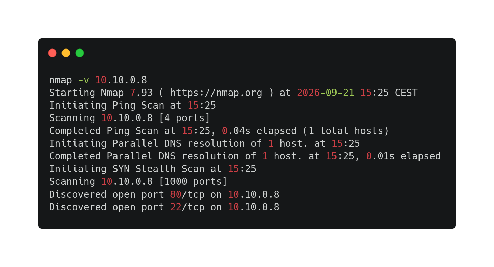
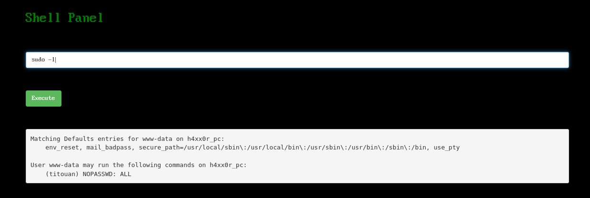
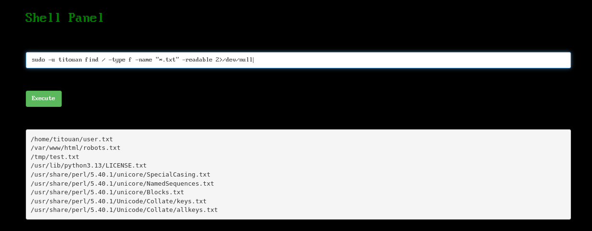
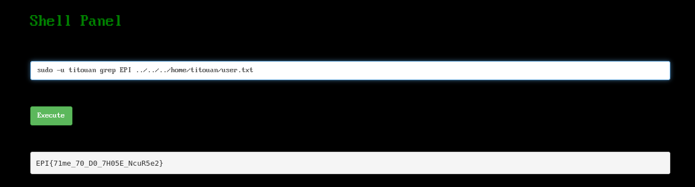

--- 

### Challenge propertie(s) :
- ##### Difficulty : easy
- ##### Techniques : scan, enumeration, website analysis
- ##### tools : nmap, gobuster, ffuf 
- ###### tools used but output can't be exploited  :zsteg, stegsolve, strings

### Challenge steps : 

#### Part 1 : user.txt

1.  Firstly, I scanned the network with nmap and see two basci open port : 80 and 22.

2. I navigated on the website, I read the landing page and I checked the source code and I see this : `STOP READING if you're not me! Remember username: d4rk_T1t0u4N` giving me easily the username.

3. Then, I used gobuster and ffuf (for the same reason but ffuf was faster) to enumerate website directories. 
4. I download all files on assets , and tried to extract hidden datas (png , font files etc.), with zsteg, stegsolve, strings etc but nothing relevant . 
5. The result of ffuf with big.txt wordlist, shows me a path `/robots.txt`. "User-agent: *
	Disallow: /1337_53CR37_l41r" , the path `/1337_53CR37_l41r` prints me a page with a password on it. So we have an username and a password. I tried to connect on ssh port but I creds were wrong. 

6. Exploring this website : https://www.freecodecamp.org/news/web-security-fuzz-web-applications-using-ffuf/, It gaves me an idea, to enumerate directories with extensions with the flag `-e`. Then, I found many results such as login.php, forbidden.php, portal.php. So I navigated on login.php and put credentials that have seen before. 

7. An OS Command Injection in the website, so I could navigate in the linux system. 

8. With commands injected to find an user.txt or creds. I found that my user can executes all commands as the user "titouan" without passwords. 

9. A big vulnerability , so these commands could give me the flag "user.txt" : 

The command `cat` to prints the content of the text file didn't work, even `more`, `tail`, `tac`, `less` etc. So i used `grep EPI` because I knew that in the flag , the string "EPI" is always in. 