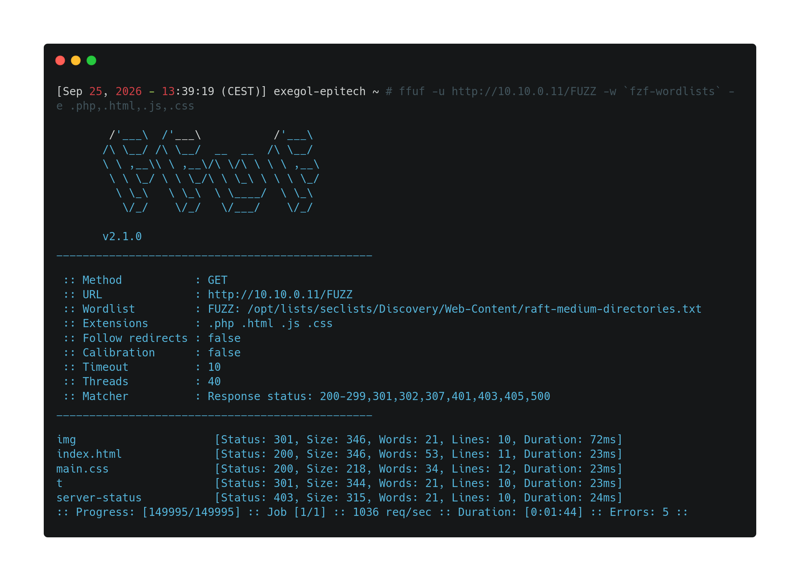
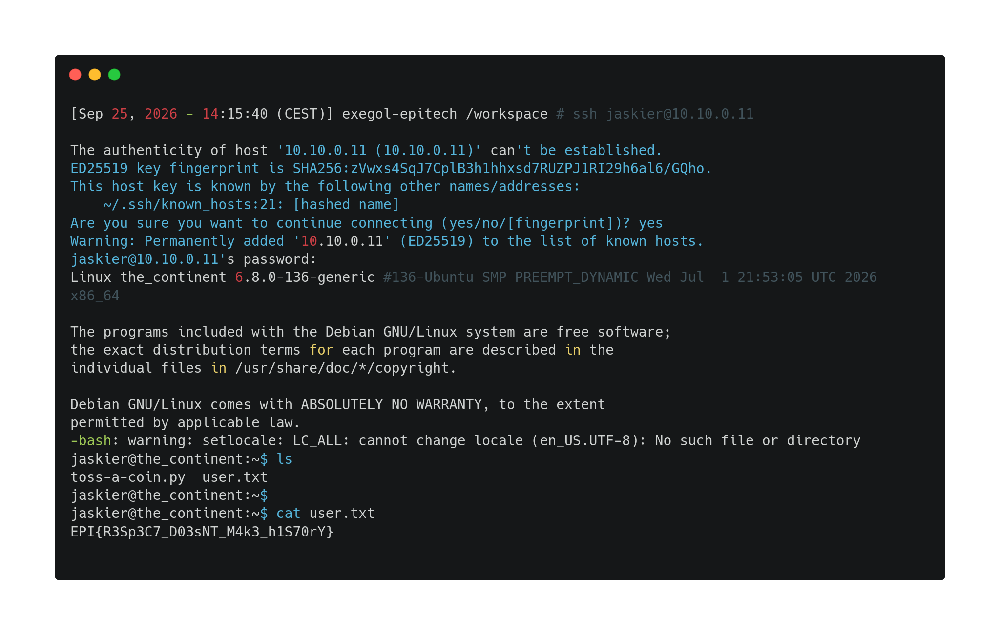

--- 
### Challenge propertie(s) :
- ##### Difficulty : easy
- ##### Techniques : scan, enumeration, website analysis
- ##### tools : nmap, ffuf

### Challenge steps : 

#### Part 1 : user.txt

1. A basic nmap scan, that reveals there is a http website and ssh open port , so I navigated on it, and tried to analyze it.

2. I enumerated directories of this website to check hidden directories.
At img path , two images are here , I downloaded it to check to steganalize them . But nothing relevant found. 
The path 't' interested me, I navigated on it , and a sentence was written , something about the lyrics of the song "toss a coin to your witcher". I thought that I could get credentials in the lyrics. 

3. In the website path http://10.10.0.11/t/ , I added a o and the same page was shown etc , up to get http://10.10.0.11/t/o/s/s, but still the same page, I kept writing the lyrics in the page , adding a 'a' , but it gave me an 404 error, given that there is a space in the lyrics , I tried to put a %20, but 404 again. 

4. So to automatically enumerate the lyric in the url path. I again used ffuf with this command -> `ffuf -u http://10.10.0.11/t/o/s/s/FUZZ -w <(printf '%s\n' {a..z} {A..Z} {0..9} "'" "-" "_")` and I found that spaces are written with a '_'. 

5. So I kept writing the lyrics in the url , when I found a new page at this url : http://10.10.0.11/t/o/s/s/_/a/_/c/o/i/n/_/t/o/_/y/o/u/r/_/w/i/t/c/h/e/r/_/o/h/_/v/a/l/l/e/y/_/o/f/_/p/l/e/n/t/y/ .
	Nothing really relevant on the page, so I checked the source code and saw this :
	 `jaskier:YouHaveTheMostIncredibleNeckItsLikeASexyGoose`
	this can be credentials , so I tried to ssh connect with "jaskier" as the username.  
